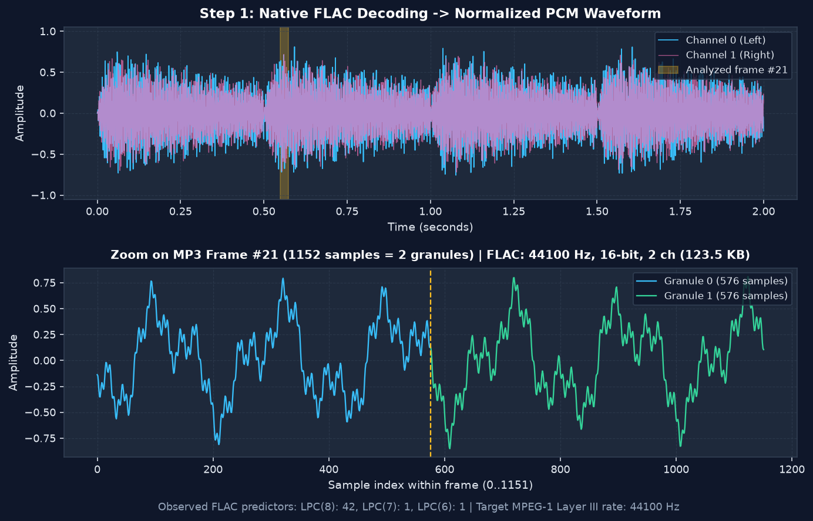
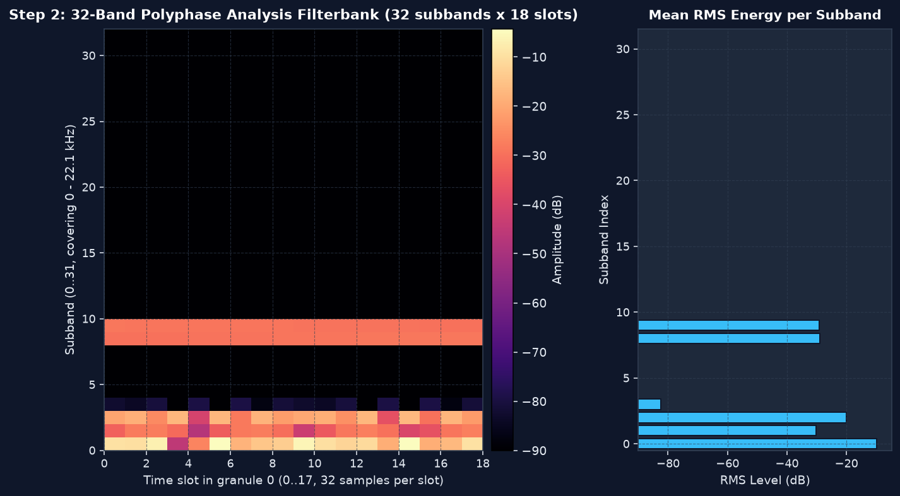
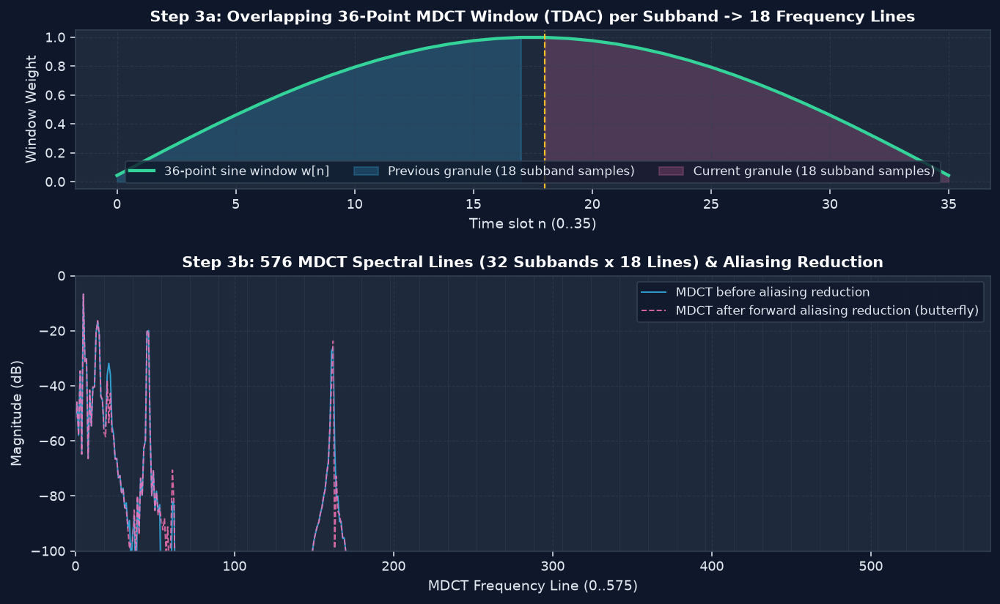
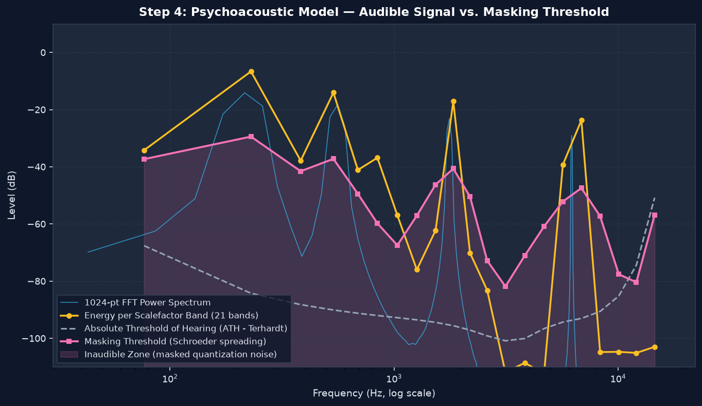
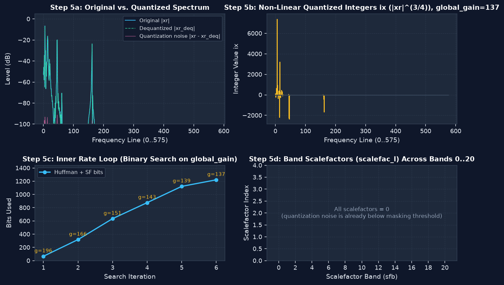
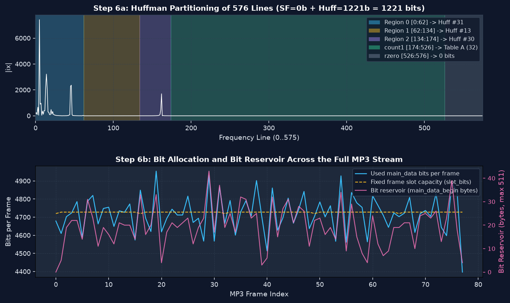
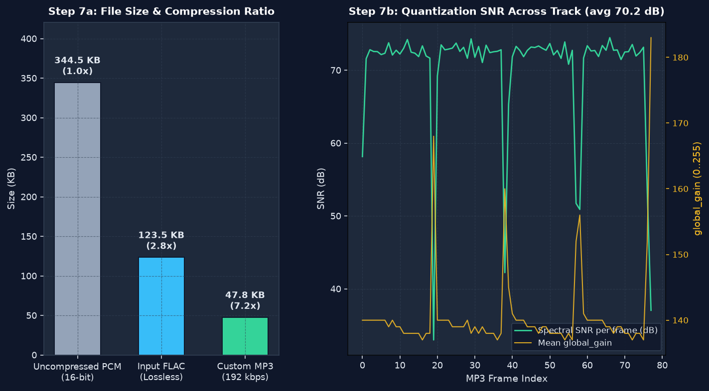

# Custom Python 3 FLAC-to-MP3 Compiler

A complete, from-scratch **MPEG-1 Audio Layer III (`.mp3`) compiler** and **native FLAC (`.flac`) decoder** implemented in Python 3 — without invoking external audio encoders (`ffmpeg`, `lame`, `pydub`, etc.) — complete with step-by-step visualizations of the entire compression pipeline.

---

## Repository Structure

| File | Description |
| :--- | :--- |
| `flac2mp3.py` | CLI entry point that decodes `.flac`, compiles `.mp3`, and generates step-by-step visualizations. |
| `flac_decoder.py` | Pure Python 3 native FLAC decoder (`STREAMINFO`, `CONSTANT`, `VERBATIM`, `FIXED 0–4`, `LPC 1–32`, Rice entropy coding, stereo decorrelation). |
| `mp3_encoder.py` | Custom MPEG-1 Layer III encoder (Lanczos-3 resampling, 32-band polyphase filterbank, MDCT + aliasing reduction, psychoacoustic model, non-uniform quantization, inner/outer RD loop, 34 ISO Huffman tables, bit reservoir). |
| `mp3_tables.py` | Standard ISO/IEC 11172-3 normative tables (`ENWINDOW`, `SFB_LONG`, `SLEN1/2`, `PRETAB`, `CS`/`CA`, `HUFFMAN_TABLES` 0–33). |
| `visualizer.py` | Generates 7 high-resolution step-by-step PNG charts and an interactive HTML report (`index.html`). |
| `test_mp3_compiler.py` | Automated test suite that compiles synthetic `.flac` files to `.mp3` and verifies decoded waveform fidelity via `soundfile` (`libmpg123`). |
| `demo_input.flac` / `demo_output.mp3` | Sample 2.0 s stereo input and compiled 192 kbps MP3 output. |
| `demo_output_visualization/` | Generated step-by-step PNG figures and interactive `index.html`. |

---

## Usage

```powershell
python flac2mp3.py input.flac output.mp3 --bitrate 192 --open
```

Options:
- `--bitrate` (`32`–`320`, default `192` kbps)
- `--vis-dir` (custom visualization output directory; defaults to `<output>_visualization`)
- `--no-vis` (skip generating visualizations)
- `--open` (automatically open the interactive HTML report in your browser)

Run the automated tests:

```powershell
python test_mp3_compiler.py
```

---

## Pipeline Walkthrough & Mathematical Foundations

### Step 1: Native FLAC Decoding to Normalized PCM



A FLAC frame stores lossless audio as a **linear prediction** plus a **Rice-coded residual** $e[n]$:

1. **Zigzag & Rice Entropy Decoding:** Unsigned folded values $u = (q \ll r) \mid b$ (unary quotient $q$ and $r$-bit remainder $b$) map back to signed residuals:

$$
e[n] = (u \gg 1) \oplus -(u \bmod 2)
$$

2. **Linear Prediction (`FIXED` / `LPC`):** For order-$p$ LPC with quantized coefficients $a[j]$ and right-shift `qlp_shift` ($Q$):

$$
x[n] = \left\lfloor \frac{\sum_{j=1}^{p} a[j] \cdot x[n - j]}{2^{Q}} \right\rfloor + e[n]
$$

3. **Stereo Decorrelation:** Mid/Side channels $(M, S)$ are reconstructed bit-exactly via:

$$
M' = 2M + (S \bmod 2), \qquad L = \left\lfloor \frac{M' + S}{2} \right\rfloor, \qquad R = \left\lfloor \frac{M' - S}{2} \right\rfloor
$$

4. Samples are normalized to $x[n] \in [-1, 1]$ and grouped into MP3 frames of $1152$ samples ($2$ granules of $576$ samples each).

---

### Step 2: 32-Band Polyphase Analysis Filterbank



For every $32$ new PCM samples shifted into a $512$-sample FIFO buffer $X[0..511]$ (with $X[0]$ newest), the encoder applies the ISO/IEC 11172-3 512-tap prototype low-pass window $C[i]$ (`ENWINDOW`), folds into 64 polyphase components, and modulates into 32 uniform frequency subbands $k \in \{0, \dots, 31\}$:

$$
Z[i] = C[i] \cdot X[i], \qquad Y[j] = \sum_{m=0}^{7} Z[j + 64m] \quad (j = 0, \dots, 63)
$$

$$
S[k] = \sum_{j=0}^{63} Y[j] \cos\left(\frac{(2k + 1)(j - 16)\pi}{64}\right)
$$

Repeating this 18 times per granule produces an $18 \times 32$ time-frequency subband matrix per channel.

---

### Step 3: MDCT & Forward Aliasing Reduction



To achieve fine spectral resolution (576 lines instead of 32), each subband $k$ combines $18$ slots from the previous granule and $18$ slots from the current granule ($N = 36$) after odd-subband time-slot sign inversion:

$$
S[k, s] \leftarrow (-1)^{(k \bmod 2)(s \bmod 2)} S[k, s]
$$

1. **Windowed Princen–Bradley MDCT:** With the $36$-point sine window $w[n] = \sin\left(\frac{\pi}{36}(n + \frac{1}{2})\right)$ (satisfying the TDAC condition $w[n]^2 + w[n+18]^2 = 1$), the 18 MDCT spectral coefficients for subband $k$ are:

$$
X_k[m] = \frac{1}{9} \sum_{n=0}^{35} x_k[n] w[n] \cos\left(\frac{\pi}{72}(2n + 19)(2m + 1)\right), \qquad m \in \{0, \dots, 17\}
$$

2. **Forward Aliasing Reduction Butterflies:** Because the 32 polyphase subbands overlap, adjacent subbands $k$ and $k+1$ exhibit spectral aliasing across the 8 boundary lines ($i = 0, \dots, 7$). Given ISO coefficients $c[i]$, the encoder applies the orthogonal inverse of the decoder's butterfly rotation:

$$
cs_i = \frac{1}{\sqrt{1+c[i]^2}}, \qquad ca_i = \frac{c[i]}{\sqrt{1+c[i]^2}}
$$

$$
\begin{bmatrix} X'_{k}[17 - i] \\ X'_{k+1}[i] \end{bmatrix} = \begin{bmatrix} cs_i & ca_i \\ -ca_i & cs_i \end{bmatrix} \begin{bmatrix} X_{k}[17 - i] \\ X_{k+1}[i] \end{bmatrix}
$$

---

### Step 4: Psychoacoustic Model (Bark Scale, ATH & Masking)



A 1024-point Hann-windowed FFT estimates the power spectrum and tonality of each granule, while MDCT line energies are summed across the 21 ISO scalefactor bands $b \in \{0, \dots, 20\}$:

1. **Bark Critical-Band Mapping:**

$$
z(f) = 13 \arctan(0.00076 f) + 3.5 \arctan\left(\left(\frac{f}{7500}\right)^2\right)
$$

2. **Absolute Threshold of Hearing (Terhardt, 1979):**

$$
\mathrm{ATH}(f) = 3.64 f_{\mathrm{kHz}}^{-0.8} - 6.5 e^{-0.6 (f_{\mathrm{kHz}} - 3.3)^2} + 10^{-3} f_{\mathrm{kHz}}^{4} \quad [\mathrm{dB\ SPL}]
$$

3. **Schroeder Spreading & Masking Threshold:** Energy spreads across critical-band distances $\Delta z = z[j] - z[i]$ via:

$$
S_{\mathrm{dB}}(\Delta z) = 15.81 + 7.5(\Delta z + 0.474) - 17.5\sqrt{1 + (\Delta z + 0.474)^2}
$$

Combined with the Spectral Flatness Measure $\mathrm{SFM} = \frac{\exp(\mathbb{E}[\ln P])}{\mathbb{E}[P]}$ to distinguish tonal maskers from noise-like signals, any quantization error below the resulting masking threshold $T[b]$ is masked by the human auditory system.

---

### Step 5: Non-Linear Quantization & Rate-Distortion Loop



MPEG-1 Layer III uses non-uniform power-law companding so relative quantization precision remains roughly constant across quiet and loud spectral lines. Let $g$ denote `global_gain`, $s$ denote `scalefac_scale`, $p$ denote `preflag`, and $\mathrm{sf}[b]$ denote `scalefac_l[b]`:

$$
\Delta_b = g - 210 - 2^{1 + s}\left(\mathrm{sf}[b] + p \cdot \mathrm{pretab}[b]\right)
$$

$$
|ix[i]| = \left\lfloor \left(\frac{|xr[i]|}{2^{\Delta_b / 4}}\right)^{3/4} + 0.4054 \right\rfloor, \qquad \widehat{xr}[i] = \mathrm{sgn}(ix[i]) \cdot |ix[i]|^{4/3} \cdot 2^{\Delta_b / 4}
$$

Two nested optimization loops control bitrate and perceptual distortion:
- **Inner Loop (Rate Control):** Binary search on `global_gain` ($g \in [0, 255]$) so that `part2_bits + huffman_bits` fits within the granule bit budget ($\le 4095$ bits).
- **Outer Loop (Distortion Control):** Computes per-band noise $D[b] = \sum_{i \in b} (xr[i] - \widehat{xr}[i])^2$ and increases `scalefac_l[b]` for bands where the Noise-to-Mask Ratio $D[b] / T[b] > 1$, then re-runs the inner loop.

---

### Step 6: Huffman Entropy Coding & Bit Reservoir



The 576 quantized integers are ordered from low to high frequencies and split into three zones:
1. **`big_values`:** Partitioned along scalefactor band boundaries into 3 regions (`region0`, `region1`, `region2`). Each region selects the minimum-bit ISO Huffman table (Tables 1–31, with `linbits` escape coding for $|ix| \ge 15$).
2. **`count1`:** Trailing quadruples with entries in $\{-1, 0, +1\}$, coded with Table A (32) or Table B (33).
3. **`rzero`:** All remaining high-frequency zeros up to index 575, coded with **0 bits**.

To handle transient frames without violating Constant Bitrate (CBR), unused bytes from simpler frames accumulate in a **bit reservoir** (`main_data_begin`, up to 511 bytes), where $\mathrm{slot}[f]$ is available slot bytes and $\mathrm{main}[f]$ is main data bytes written in frame $f$:

$$
R[f+1] = R[f] + \mathrm{slot}[f] - \mathrm{main}[f], \qquad 0 \le R[f] \le 511
$$

---

### Step 7: Compression & Quality Verification



Each MPEG-1 Layer III frame has an exact byte size determined by bitrate $B$ (bps), sample rate $f_s$ (Hz), and padding bit $p \in \{0, 1\}$:

$$
N_{\mathrm{frame}} = \left\lfloor \frac{144 \cdot B}{f_s} \right\rfloor + p
$$

Per-frame spectral Signal-to-Noise Ratio is measured as:

$$
\mathrm{SNR}_{\mathrm{dB}} = 10 \log_{10} \left( \frac{\sum_{i=0}^{575} xr[i]^2}{\sum_{i=0}^{575} \left(xr[i] - \widehat{xr}[i]\right)^2} \right)
$$

On the included `demo_input.flac` (2.00 s, 44.1 kHz stereo), encoding at 192 kbps achieves a **7.2x** compression ratio over raw 16-bit PCM (**344.5 KB** PCM &rarr; **123.5 KB** FLAC &rarr; **47.8 KB** MP3) with an average spectral SNR of **70.2 dB**.
